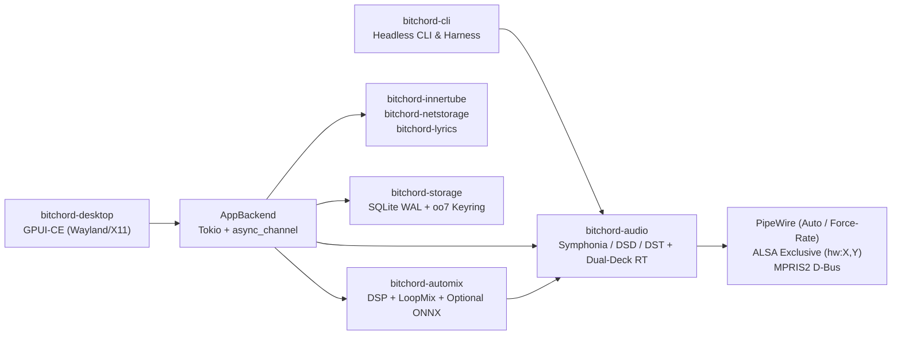

# Myusic

**Native Linux Desktop Music Player built in 100% safe Rust + GPUI.**

[](https://www.rust-lang.org/)
[](https://crates.io/crates/gpui-ce)
[](#workspace-architecture)
[-blue.svg)](#prerequisites)
[](LICENSE)

Myusic is a fast, native Linux desktop music player written from the ground up in Rust (14 modular crates, `#![forbid(unsafe_code)]` workspace-wide) with a GPU-accelerated [GPUI-CE](https://crates.io/crates/gpui-ce) interface, a zero-allocation real-time dual-deck audio engine, bit-perfect ALSA/PipeWire output, pure-Rust DSD/DST playback, Smart Automix & LoopMix, WebDAV/SMB2/3 network libraries, 17-source synced lyrics, and full protocol parity with BitChord's Go Listen Together backend.

> Migrated and evolved for Linux desktop from [BitChord](https://github.com/kushagrasinghx/BitChord) (v1.9.1, GPLv3). Internal Cargo package names retain the `bitchord-*` prefix while the desktop application brand is **Myusic**.

---

## Highlights

### Audiophile Audio Engine & Hardware Output
- **Zero-Allocation Real-Time Dual-Deck Mixer**: Lock-free `rtrb` ring buffers feeding dedicated PipeWire or ALSA RT threads with prebuffered opening frames so track starts never clip or stutter.
- **Bit-Perfect Hardware Output**:
  - **PipeWire Auto (48 kHz)** for seamless desktop mixing.
  - **PipeWire Force-Rate** (`node.force-rate`) for dynamic native clock switching.
  - **ALSA Exclusive (`hw:X,Y`)** direct hardware sink with automatic `/proc/asound` + `/sys/class/sound` USB DAC discovery and bit-exact `S32_LE`, `S24_3LE`, `FLOAT_LE`, and `S16_LE` output.
  - **Honest Bit-Perfect Telemetry**: Stats for Nerds reports `BIT-PERFECT` only when hardware clock matches source rate with zero resampling, unity gain, and DSP bypassed.
- **Native Pure-Rust DSD / DST & DoP**:
  - Transparent container sniffing for `.dsf` and `.dff` (DSDIFF) from **DSD64 (2.8224 MHz)** through **DSD1024 (45.1584 MHz)**.
  - Nibble-LUT Blackman-windowed sinc decimator (`DSD -> 176.4 kHz f32`), pure-Rust ISO/IEC 14496-3 Subpart 10 lossless **DST** decoder with CRC-32 verification, and **DoP v1.1** (`0x05` / `0xFA`) framing.
- **Float32 DSP Chain**: 7-band 10-slot SVF Equalizer (10 presets + custom per-band gain), Spatial Crossfeed, Loudness Normalization with headroom limiter, Skip Silence, and pitch-preserving WSOLA time-stretching (`0.5x`–`2.0x`).

### Smart Automix, LoopMix & Optional ONNX
- **Pure-Rust Musical Analyzer**: Streaming `11,025 Hz` analyzer extracting 250 ms RMS envelopes, spectral flux onsets, BPM (`70`–`200` with metrical octave resolution), two-pass PLL beat grid, bass-weighted 4/4 downbeats, 8-bar phrase boundaries, Krumhansl-Schmuckler 24-key detection (Camelot codes), low-end energy, and vocal activity curves.
- **DJ Transition Engine**: Automated 8/16-bar Phrase Mix, DJ Bass Swap, DJ Filter Sweep (LP/HP), vocal-clash avoidance, beatmatched incoming tempo alignment (`0.90x`–`1.25x`), and **LoopMix** analytical tempo-ramp looping with SQLite `track_analysis` caching.
- **Optional Neural Refinement (`--features automix-onnx`)**: Dynamically loads `libonnxruntime.so` for `beat_this_final0_q8.onnx` and `vocals_umxhq_int8.onnx` with strict laptop-safe caps (`intra_threads <= 2`, `inter_threads = 1`, arena disabled), falling back cleanly to pure-Rust DSP when models or runtime are absent.

### Streaming, Network Libraries & Integrations
- **YouTube Music Streaming**: Native InnerTube client + QuickJS-NG (`rquickjs`) cipher sandbox + bounded 1 MiB HTTP `Range` streaming with optional `yt-dlp` bridge fallback (`ytdlp-bridge` feature).
- **Network Storage (WebDAV & SMB2/3)**: Pure-Rust WebDAV (`PROPFIND` recursive walk, Basic Auth) and SMB2/3 (`smb` crate, 128 KiB LRU seekable range reader) with automatic folder cover-art pairing and Linux Secret Service credential storage (`oo7`).
- **17-Source Synced Lyrics**: Parallel provider racing (LRCLIB, BetterLyrics, KuGou, Musixmatch, Genius, YouTube Music timed transcripts, and more) with word-by-word karaoke sync, smooth auto-scroll, and inline translation.
- **Desktop Ecosystem**: Native Wayland & X11 GPU rendering, dynamic 64x64 artwork mesh backdrop, Dark OLED & Light Studio themes (WCAG AA contrast verified), **MPRIS2** D-Bus media controls, System Tray close-to-background lifecycle, **Listen Together** party sync, **Spotify** public playlist import, **Discord Rich Presence**, and **Last.fm / ListenBrainz** scrobbling.

---

## Architecture Overview



### Workspace Architecture

All 14 crates enforce `#![forbid(unsafe_code)]` and compile cleanly under `clippy --all-targets -- -D warnings`.

| Crate | Purpose |
| --- | --- |
| `bitchord-model` | Core domain types (`Song`, `HomeFeed`, `SearchResult`, `CanvasArtwork`), duration parsing, and sorting |
| `bitchord-jam` | Listen Together invite parsing, server clock sync, and Go backend JSON wire protocol |
| `bitchord-dsp-core` | Zero-dependency Float32 SVF Equalizer, Peak Limiter, and 4th-order Butterworth transition filters |
| `bitchord-matcher` | Cross-source track identity matching (NFKC, CJK/Hepburn transliteration, version/explicit guards) |
| `bitchord-queue` | Deterministic multi-tier queue timeline (`UserQueue`, `Context`, `Autoplay`), shuffle, and repeat |
| `bitchord-lyrics` | 17-source lyrics provider racer, TTML / Enhanced LRC / syllable sync parser, and translator |
| `bitchord-innertube` | YouTube Music InnerTube API, QuickJS-NG cipher sandbox, stream resolver, and optional `yt-dlp` bridge |
| `bitchord-integrations` | Listen Together WebSocket client, Spotify importer, Discord IPC, Last.fm/ListenBrainz, NerdStats |
| `bitchord-netstorage` | Pure-Rust WebDAV and SMB2/3 recursive library indexer, cover pairing, and seekable range streaming |
| `bitchord-automix` | Pure-Rust DSP beat/key/vocal analyzer, DJ transition planner, LoopMix renderer, and optional ONNX backend |
| `bitchord-storage` | XDG paths, atomic JSON settings, SQLite WAL DB (with `track_analysis` cache), `oo7` Secret Service, audio taggers |
| `bitchord-audio` | Dual-deck RT engine, Symphonia + libopus, pure-Rust DSF/DFF/DST + DoP, PipeWire, ALSA Exclusive, MPRIS2 |
| `bitchord-cli` | Headless CLI front-door for streaming, playback, ALSA probing, Automix analysis, and network shares |
| `bitchord-desktop` | Native Linux GPUI-CE desktop client with System Tray, Now Playing stage, Queue drawer, and Settings |

---

## Prerequisites

- **Rust toolchain**: `1.95+` (Edition 2024)
- **Linker**: `clang` + `lld` (configured in [.cargo/config.toml](.cargo/config.toml) for low-RAM, laptop-friendly linking)
- **System libraries**: PipeWire, ALSA (`alsa-lib`), Opus, SQLite 3, Wayland/XCB + `libxkbcommon`, Vulkan driver, and optional `yt-dlp` / `onnxruntime`

### Arch Linux
```bash
sudo pacman -S --needed rust clang lld pkgconf pipewire alsa-lib opus sqlite \
  libxkbcommon wayland libxcb vulkan-icd-loader yt-dlp
```

### Debian / Ubuntu
```bash
sudo apt install clang lld pkg-config libpipewire-0.3-dev libasound2-dev \
  libopus-dev libsqlite3-dev libxkbcommon-dev libxkbcommon-x11-dev \
  libwayland-dev libxcb1-dev libvulkan-dev yt-dlp
```

### Fedora
```bash
sudo dnf install clang lld pkgconf-pkg-config pipewire-devel alsa-lib-devel \
  opus-devel sqlite-devel libxkbcommon-devel libxkbcommon-x11-devel \
  wayland-devel libxcb-devel vulkan-loader-devel yt-dlp
```

---

## Build & Run

`bitchord-desktop` is intentionally excluded from workspace `default-members` so core checks stay fast on modest laptops.

```bash
git clone https://github.com/adttsonaisse/myusic-app.git
cd myusic-app

# Build and launch the Myusic desktop app (capped to 2 parallel jobs for laptop thermal safety)
cargo run -j 2 -p bitchord-desktop

# Build an optimized release binary
cargo build --release -j 2 -p bitchord-desktop
./target/release/bitchord-desktop
```

### Enabling Optional ONNX Automix Acceleration
By default, Smart Automix and LoopMix run 100% offline using the built-in pure-Rust DSP analyzer. To optionally refine beat grids and vocal masks with ONNX Runtime:

1. Place `beat_this_final0_q8.onnx` and/or `vocals_umxhq_int8.onnx` inside `~/.local/share/bitchord/models/` (or set `BITCHORD_MODELS_DIR`).
2. Install system `onnxruntime` (or set `ORT_DYLIB_PATH=/path/to/libonnxruntime.so`).
3. Build with `--features automix-onnx`:
   ```bash
   cargo build -j 2 -p bitchord-desktop --features automix-onnx
   ```

---

## Headless CLI (`bitchord-cli`)

Every core subsystem is scriptable and inspectable from the terminal (append `--json` for machine-readable output):

```bash
# Probe ALSA hardware endpoints and USB DACs
cargo run -p bitchord-cli -- devices

# Play local FLAC, MP3, Opus, DSD (.dsf/.dff), WebDAV, SMB, or YouTube videoId
cargo run -p bitchord-cli -- play /path/to/album/01.dsf --output-mode pipewire-force-rate --mpris
cargo run -p bitchord-cli -- play /path/to/track.flac --output-mode alsa-exclusive --alsa-device hw:1,0
cargo run -p bitchord-cli -- play "webdav:https://nas.local/dav/music/track.flac" --remote-user me --remote-pass secret

# Smart Automix & LoopMix analysis and transition planning
cargo run -p bitchord-cli -- automix status
cargo run -p bitchord-cli -- automix analyze /path/to/track_a.flac
cargo run -p bitchord-cli -- automix plan /path/to/track_a.flac /path/to/track_b.flac --mode advanced --phrase-bars 8

# Browse WebDAV / SMB2/3 music shares
cargo run -p bitchord-cli -- netstorage webdav-list --url https://nas.local/dav/music --user me --pass secret
cargo run -p bitchord-cli -- netstorage smb-list --host 192.168.1.10 --share Music --user guest

# Search YouTube Music & fetch synced lyrics
cargo run -p bitchord-cli -- search "Kavinsky Nightcall"
cargo run -p bitchord-cli -- lyrics --title "Nightcall" --artist "Kavinsky"
```

---

## Keyboard Shortcuts

Scoped so typing in search or settings inputs is never hijacked:

| Shortcut | Action |
| --- | --- |
| `Space` | Play / Pause |
| `N` / `P` | Next / Previous track |
| `Ctrl + Right` / `Ctrl + Left` | Seek forward / backward |
| `Ctrl + Up` / `Ctrl + Down` | Volume up / down |
| `M` | Toggle mute |
| `Q` | Toggle Queue drawer |
| `L` | Toggle Now Playing / Lyrics stage |
| `Ctrl + F` | Focus search |
| `Ctrl + T` | Toggle Dark OLED / Light Studio theme |
| `Esc` | Close active overlay / window |
| `Ctrl + Q` | Quit Myusic completely (exits tray) |

---

## Linux XDG Data Paths

| Purpose | Default Path |
| --- | --- |
| Settings (`settings.json`) | `~/.config/bitchord/settings.json` |
| SQLite Library & `track_analysis` DB | `~/.local/share/bitchord/library.sqlite3` |
| Private Offline Downloads | `~/.local/share/bitchord/downloads/` |
| Optional Automix ONNX Models | `~/.local/share/bitchord/models/` |
| Artwork & Lyrics Translation Cache | `~/.cache/bitchord/` |
| Passwords & Auth Cookies | Linux Secret Service (`org.freedesktop.secrets` via `oo7`) |

---

## Verification & Tests

```bash
# Formatting check
cargo fmt --all -- --check

# Core workspace tests (13 crates, 342 tests) & strict lints
cargo test
cargo clippy --all-targets -- -D warnings

# Desktop crate tests (7 tests) & strict lints
cargo test -j 2 -p bitchord-desktop
cargo clippy -j 2 -p bitchord-desktop --all-targets -- -D warnings

# Verify optional ONNX feature compiles cleanly
cargo clippy -p bitchord-automix -p bitchord-audio -p bitchord-cli --features automix-onnx --all-targets -- -D warnings
```

---

## Credits & License

- Original Android/KMP architecture, Listen Together protocol, and DSP/Automix design inspired by [BitChord](https://github.com/kushagrasinghx/BitChord) by Kushagra Singh.
- Licensed under the **GNU General Public License v3.0 only** ([LICENSE](LICENSE)).
